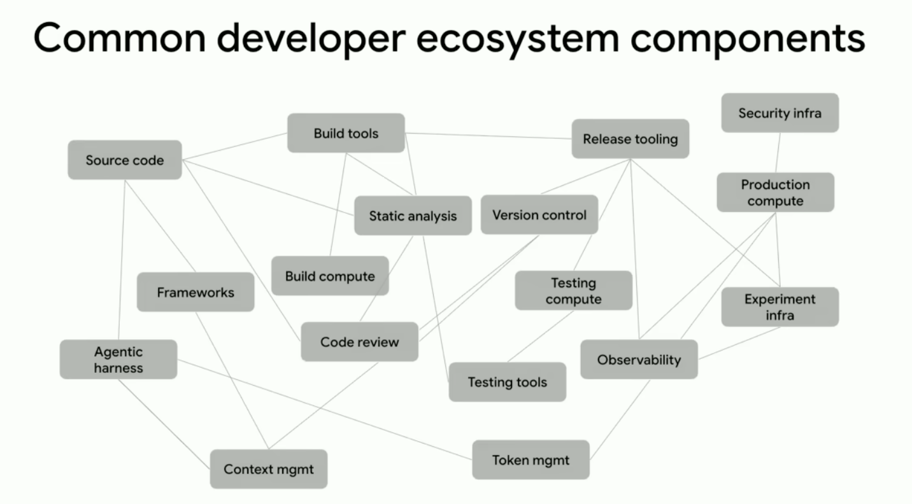
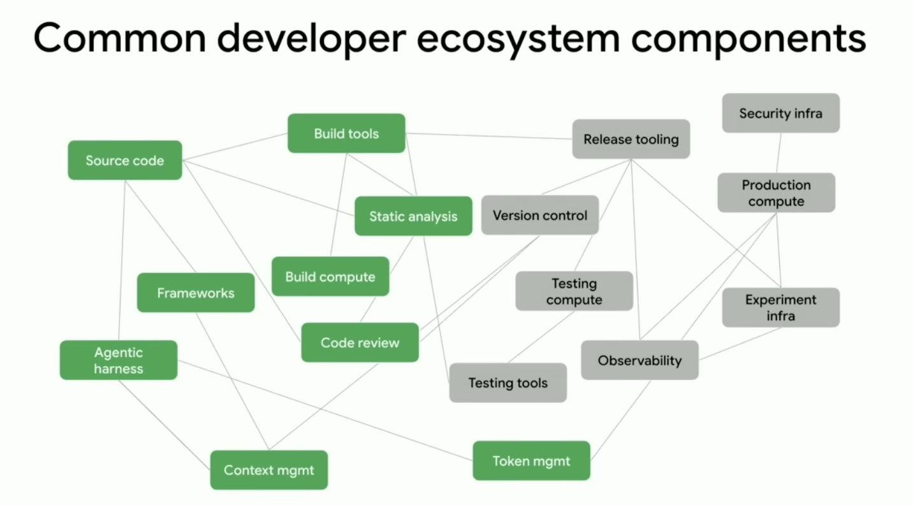
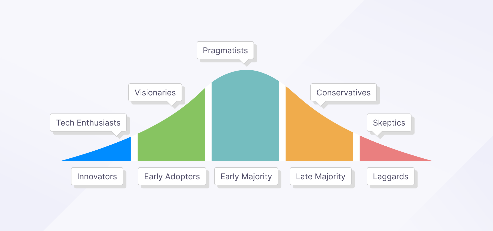

This talk by Adam Bender stopped us in our tracks. It articulates something we feel every day at [Najaa Technologies](https://www.najaa.org): the challenge of building software in an era of rapid, systemic change is not just a technical problem; it is a cultural and organizational one. The ideas here around software ecology, shared fate, and the amplifying nature of AI mirror the discipline and engineering culture we are actively working to build and maintain.

These are our notes from the talk, with the ideas that resonated most.

# Software ecology

Software development in 2026 feels very different. The pace of change is high, and the pressure is not just technical anymore; it is socio-technical.

A system is a group of interrelated elements that follow rules to form a unified whole. As software engineers, we build systems all the time, so we already know the key lesson: everything is connected.

An ecosystem is broader than a system. It is a dynamic network of interdependent actors that co-evolve with their environment, with emergent behavior and decentralized agency. That is the better model for modern software organizations: tools, services, people, business goals, and opinionated workflows all mixed together.

Conway's law explains part of this well: organizations build technology that mirrors their communication structure. Engineering culture shapes the ecosystem, and the ecosystem shapes what gets built. In that sense, software is people, and technology is one way we amplify our values and outcomes.

# Google as an ecosystem example

One of the clearest examples of a deliberately shaped ecosystem is Google. If you do not understand the engineering culture, you will struggle to understand the technical choices.

## Cultural components

- Engineering-led decision making
- Transparency by default
- Be helpful and share what you know
- Code review as mentorship
- Standardization is valuable
- Continuous improvement together
- Blameless postmortems
- Sustainability over heroics
- Automation over toil

## Technical components

- Monolithic repositories
- Trunk-based development with true CI
- Almost every line built from source
- Universal build toolchain
- Global test automation platform
- A global signal for the last green build
- Code search across the whole codebase
- Uniform compute environments
- Opinionated developer frameworks
- A small core language set

The principle underneath this is shared fate: the degree to which the parts of an ecosystem are tightly linked to each other. One component can affect everything else. At Google, that shared fate is reinforced by the monorepo, which makes large-scale changes possible and keeps the organization moving quickly.

# The AI-first question

The real question is not whether AI can write code faster. It can. The harder question is whether the rest of the engineering ecosystem can absorb that speed.

You cannot hand developers tokens and subscriptions and say good luck. The workflow has to change with them. Existing systems still need to ship, and the organization still has to understand its own bottlenecks, constraints, and capacity.

Agents tend to optimize for what is easy to write now, not what is easy to maintain later. That makes design discipline more important, not less. More code means more compile time, more build time, and more review pressure.

# Where scale starts to hurt

The obvious pressures are easy to count.

- More commits mean more review load.
- More tests mean more compute.
- Larger codebases mean more expensive dependency graphs.
- Version control systems are built for correctness and safety, not raw speed.
- Bigger releases create more risk for SRE and operations teams.

But the less obvious problems matter just as much.

- Validation becomes harder when not every test can run every time.
- Large changes create merge conflicts and agentic edit wars.
- Internal APIs become public in practice unless they are hardened.
- Token budgets become a real operational constraint.
- Human attention becomes a scarce resource.

At some point, the question stops being "can we produce more code?" and becomes "can we still understand and verify the system we are changing?"

# Innovation adoption is uneven

Not every team will move at the same speed. Some people are innovators, some are pragmatists, some are skeptics, and some need to see the system work before they trust it.

That is why adoption strategy matters. You need to know where your teams sit on the curve, where the blockers are, and which habits need to change first. The missing piece here is not just tooling; it is retraining people to operate in the new paradigm.

# Principles that still matter

The practices will change, but the principles do not.

- Abstraction: frameworks and agent harnesses exist to stop repeated reinvention.
- Isolation: experimental work should not break money-making systems.
- Validation: the strategy for proving correctness has to evolve.
- Infrastructure capacity: AI consumes real compute, and that cost has to be managed.
- Shared fate: tightly coupled systems can move faster, but they also fail together.

The key is to separate mechanisms from principles. If you understand the principles, you can adapt the mechanisms as the ecosystem changes.

# The real job

The biggest risk is losing intellectual control over systems that are now too large for any one person to hold in their head. AI can help us map those systems, ask better questions, and reason about tradeoffs faster, but it can also amplify confusion if the foundations are weak.

That is why the human role becomes more important, not less. Be the person who helps a teammate, explains the system, and advocates for quality and design. Use the tools to extend judgment, not replace it.

If you can see the system clearly, you can find leverage. If you can find leverage, you can shape what software engineering becomes next.

## References

- [Software Engineering at the Tipping Point](https://www.youtube.com/watch?v=2n41YjR5QfU)
- [Software Engineering at Google](https://www.oreilly.com/library/view/software-engineering-at/9781492082781/)
- [DORA State of DevOps Report 2025](https://dora.dev/research/2025/dora-report/)