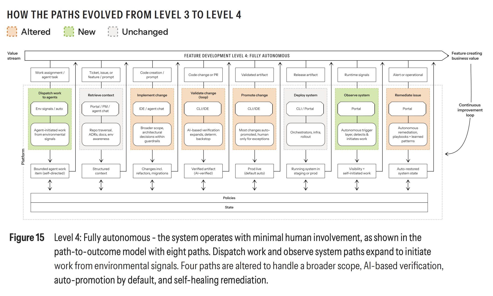

Since Claude Fable 5 was released, we've shifted our development workflow completely from traditional coding to Agentic Development. The reason for that shift was that we could confirm without a doubt that AI Agents have outpaced both our code quality and quantity.  But until today, if you browse any tech news channel or scroll through social media you'll be caught between two extreme camps: the marketing-driven "all-in" hype that claims AI is a black magic about to completely replace human software engineers, and the skeptical "doom and bubble" camp that dismisses it as a passing fad.

As a business owner operating a software development company at [Najaa Technologies](https://najaa.org), I see this transition not as a threat, but as an incredible catalyst for positive change. However, navigating this shift requires moving past the "smoke and mirrors" and understanding what generative AI actually is, how it impacts our workflows, and how we must evolve our engineering practices to deliver true, sustainable value.

This is a brief post about how how AI and agentic tooling is genuinely reshaping software engineering, and why our commitment to technical excellence and architectural maturity has never been more critical.

---

# What AI actually is

To leverage AI productively, we must strip away the marketing jargon and understand the underlying mechanics. At its core, a Large Language Model (LLM) is not a sentient being—it is a sophisticated, probabilistic next-word predictor with a deep semantic understanding of language. It understands relationships between concepts (for example, recognizing that a dog, monkey, and cat are all animals that produce distinct noises) and calculates the most logical next step in a sequence.

Why does AI excel so remarkably at code? Because programming languages are highly structured. Unlike natural language, which is full of ambiguity, code relies on precise syntax—parentheses, conditional loops, and strict semantic rules. Because LLMs thrive on structured data, translating requirements into code or converting logic from C# to Python becomes incredibly efficient.

However, because these models operate probabilistically, they can also confidently present incorrect information. Therefore, treating AI as an absolute source of truth is a recipe for failure; instead, we must treat it as a senior, incredibly fast assistant whose output must always be validated.

---

# Living in "Agent Mode"

When many people think of AI in coding, they sometimes picture inline code-completion, where the AI suggests the next line of code as you type. While that was an exciting starting point, the industry has rapidly moved beyond simple line completion.

Today, senior engineers operate in "Agent Mode." The real breakthrough comes from combining LLM reasoning with massive context windows, dynamic tool use, specialized domain skills, persistent memory, and standardized protocols. Together, these capabilities provide genuine leverage and add extraordinary value to day-to-day engineering.

Much like using a manual screwdriver versus an electrical screwdriver, or using a handsaw versus an electric saw, agents are the power tools for our craft. They amplify our leverage and take the mechanical friction out of our day-to-day activities. But young developers should be careful: power tools are dangerous and you might lose a finger or two if you are not careful! Without proper technique, safety guards, and architectural discipline, you can easily produce bugs, wipe entire databases, create disastrous security flaws, and architectural debt at machine speed.

---

# The agentic stack: tools, MCP, skills, memory, and A2A

The true leap forward in modern agentic development isn't just about raw LLM reasoning—it is the emerging architecture that turns a language model into an autonomous engineering partner:

- **Tools & Dynamic Execution:** Beyond static chat, agents execute terminal commands, run test suites, inspect databases, and apply precise code diffs directly in your workspace.
- **Model Context Protocol ([MCP](https://modelcontextprotocol.io/docs/2026-07-28/getting-started/intro)):** MCP provides an open standard connecting AI agents to internal services, live databases, observability pipelines, and developer environments. Instead of being confined to a single file, the agent gains near omni-vision across the entire full stack.
- **Skills & Domain Knowledge:** Packaged instructions and procedural workflows that agents dynamically pull in to handle complex, domain-specific tasks—from schema migrations to platform-specific deployments—without cluttering the primary prompt.
- **Persistent Memories:** Scoped context (spanning user preferences, repository-level conventions, and session state) that ensures agents retain institutional knowledge and architectural rules across sessions rather than starting from scratch every interaction.
- **Agent-to-Agent ([A2A](https://developers.googleblog.com/en/a2a-a-new-era-of-agent-interoperability/)) Collaboration:** Complex tasks rarely belong to a single generalist. With multi-agent orchestration, specialized subagents—such as dedicated codebase explorers, test-validation agents, and security reviewers—collaborate, hand off sub-tasks, and cross-validate each other's work asynchronously.

This stack is a game changer for real-world engineering. For example, debugging a thorny production incident and investigating distributed logs across interconnected services used to require an entire incident team—SREs, backend developers, and database specialists coordinating across silos. Today, an engineer equipped with MCP-connected agents, persistent repository memory, and specialized subagents can correlate distributed traces, diagnose the root cause, and draft a tested fix in minutes.

Instead of manually typing every line or jumping across multiple files, we leverage asynchronous agentic workflows. We can describe a complex change, hand it over to an agent, and let the tool inspect logs, query data, and orchestrate file edits while we focus on reviewing, refining, and testing the output.

This transitions the software developer from a manual syntax writer into a system architect and validator. It allows us to automate the tedious, repetitive tasks—like processing large, complex CSV files, writing complex migration scripts, or generating boilerplate unit tests—and claim our time back for high-leverage work.

---

# Optimizing the right things

One of the most eye-opening industry statistics comes from the [ActiveState 2019 Developer Survey](https://cdn.activestate.com/wp-content/uploads/2019/05/ActiveState-Developer-Survey-2019-Open-Source-Runtime-Pains.pdf) (and subsequent developer time studies by Haystack and Stripe), which analyzed how engineers spend a typical workday. Between alignment meetings, architectural reviews, requirements engineering, and coordinating with Product Owners and Scrum Masters, engineers averaged only around two hours of active coding time per day.

If a software development company only uses AI to speed up those two hours of coding, they are optimizing for the wrong thing. Writing code faster simply puts massive pressure downstream on code reviews, testing, and deployment systems. If the other six hours of the day—where requirements are shaped, architecture is designed, and business problems are solved—are ignored, the overall delivery pipeline remains bottlenecked.

At Najaa Technologies, we recognise that a software engineer's true role has never been just about writing code. Their role is translating complex business requirements into high value solutions that solve real world problems for users. By bringing AI into the entire Software Development Lifecycle (SDLC), from initial business analysis to production monitoring, we can streamline the entire value chain, rather than just churning out more code faster.

---

# AI is a magnifier, not a cure-all

There is a critical truth that every business leader must understand: AI is a massive magnifier of your existing engineering culture.

- If your team has a solid, mature DevOps foundation, AI will magnify your productivity and speed to market.
- If your organization has high technical debt, poor testing structures, and a disorganized codebase, AI will simply help you generate technical debt, bugs, and security vulnerabilities faster.

You cannot successfully build an AI-driven development workflow without an airtight DevOps foundation. To prevent developers from simply "YOLO-ing" code directly into production, we insist on rigorous safeguards:

- **Continuous Integration (CI) from Day One:** Ensuring all code changes are automatically compiled, built, and tested in isolation.
- **Automated Visual and Code Delta Validations:** Using automated test suites to visually compare before-and-after screenshots, ensuring that UI updates or code modifications don't introduce regressions.
- **Integrated Business Analysis:** Bringing business analysts and stakeholders directly into the loop to write clear, structured user stories (utilizing methodologies like TDD and BDD) so that AI agents can generate accurate, high-quality draft Pull Requests that engineers can carefully review.

AI doesn't replace the need for software engineering discipline; it makes it mandatory.

---

# Bridging the experience gap and embracing agnosticism

For engineers who have spent 15 years perfecting their craft, the rapid rise of AI can feel confrontational. It is natural to feel a sense of professional soul-searching when a tool can generate complex logic in seconds, something we used to take pride in.

However, we find that when experienced engineers get past the initial skepticism and invest the necessary time—which typically takes about three months of hands-on daily usage to truly "click"—they experience a profound shift in mindset. They move from focusing on immediate, narrow code fixes to exploring creative, high-level architectural patterns. They start asking the AI to present five or six different approaches to an architectural problem, sparking a collaborative dialogue that elevates their system-level thinking.

At Najaa Technologies, we foster this growth by:

- **Promoting Tool and Language Agnosticism:** AI democratises development. We are no longer rigidly married to a single technology stack or IDE. Whether our engineers are using VS Code, command-line interfaces, or specialized enterprise tools, we focus on picking the best, most secure tool for the job.
- **Active Pair Programming:** We find that engineers learn how to interact with AI most effectively not through static training slides, but by pairing up, sharing real-time workflows, and learning how their peers navigate agentic tools to solve complex problems.

---

# Looking ahead: human ingenuity and machine scale

AI is not going to replace elite software engineers. Instead, it is redefining what "elite" means.

By automating the mechanical aspects of syntax writing, AI allows our team to focus on what humans do best: system design, creative problem solving, rigorous validation, and strategic alignment with our clients’ business goals.

As a software development partner, our focus is not on how fast we can write code, but on how effectively, securely, and sustainably we can deliver software that drives real business value. The agentic catalyst is here, and we are incredibly excited to lead the way.

---

## References

- [How Elite Software Engineers Are Using Agents to Get Sh*t Done - Rob Bos](https://www.youtube.com/watch?v=mEeiw-9OC2Q)
- [The Four Levels of Agentic Software Development in the Enterprise - Weave Intelligence](https://weaveintelligence.io/research/the-four-levels-of-agentic-software-development-in-the-enterprise)
- [A2A: A New Era of Agent Interoperability - Google Developers Blog](https://developers.googleblog.com/en/a2a-a-new-era-of-agent-interoperability/)
- [Model Context Protocol (MCP) - Getting Started](https://modelcontextprotocol.io/docs/2026-07-28/getting-started/intro)
- [ActiveState 2019 Developer Survey: Open Source Runtime Pains](https://cdn.activestate.com/wp-content/uploads/2019/05/ActiveState-Developer-Survey-2019-Open-Source-Runtime-Pains.pdf)
- [Stripe: The Developer Coefficient](https://stripe.com/reports/developer-coefficient-2018)
- [DORA State of DevOps Research](https://dora.dev/research/)