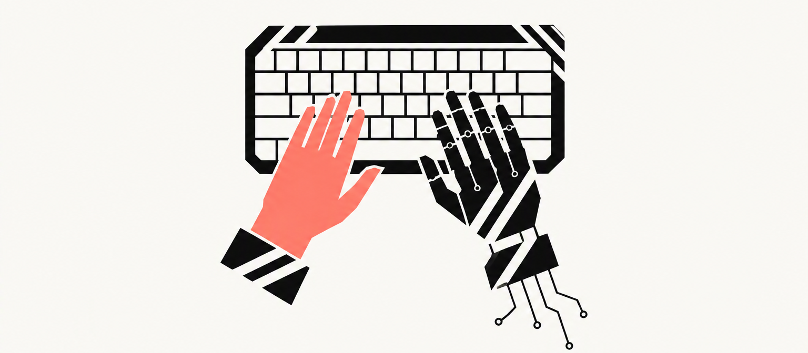

Recently I had to grade a set of assignments manually, and it took me by surprise how much I missed it. Not the grading itself, but everything that comes with it: looking at the students' scribbles, following their steps line by line, and reading the little remarks they sometimes leave on the answer booklet.

That experience got me thinking, and I realised it was not the first time this year that automation had quietly taken something away from me while making my life easier. This is a short post about three of those experiences, and the question they left me with: when should we automate, and when do we need a human in the loop?

---

# Grading: losing the thought process

When you grade papers by hand, you are doing much more than assigning marks. You see where a student started to go down the wrong path and corrected themselves. You see the step where they lost the thread. You see a half-erased attempt, a note to themselves, or sometimes a funny remark to the grader at the end of the booklet.

All of those small things help you connect with students and understand how they think. That is something you rarely get when a system like Moodle grades the assignments automatically. The system tells you the answer was wrong, but it can't tell you *why* it was wrong, or that the student was one sign error away from a perfect solution.

It also shows proof of effort. Pages of crossed-out attempts and worked steps tell you how hard a student tried, and that is sometimes hard to see in a simple textbox in Moodle, where a final answer looks the same whether it took five minutes or two hours.

You save a lot of time, but you sort of lose the connection.

---

# Lab platforms: from "why" to "how"

The second experience was with a platform that automatically grades students' lab submissions and provides built-in videos that walk through each lab.

There is no doubt the platform helped the students learn. Feedback was instant, and the guidance was always available. But I noticed something change in the way they worked: they went into autopilot mode. Their focus moved away from *why* we do the lab and toward *how* to get through the lab.

Both matter. But as an educator, the *why* is what I care about most, because it is the theory that backs up the process. A student who can follow the steps but can't explain why those steps work has completed the lab without really learning from it.

It also changed the dynamic in the classroom. The platform did the grading and the explaining, so the instructor lost value, and the platform gained more power. The students' attention shifted toward the system and away from the human teaching them. When the system is the one that answers, corrects and explains, the instructor becomes a bystander in their own lab.

---

# Event check-in: scanning a QR code is not being welcomed

The third experience was at an event, where we used a check-in system that automated the process of registering visitors.

With a paper-based process, we used to write remarks, keep physical evidence of the check-in, and, most importantly, talk to the visitors. We would ask for their name instead of asking for their "QR code".

Those small moments are where visitors really feel they are being welcomed into an event. With automation, they are just being scanned. The process is faster and cleaner, and nobody would argue that it is not, but the welcome is gone.

---

# So when do we automate?

The question still remains: when do we automate, and when is active human involvement needed?

If we automate all of our efforts, are we truly still connecting with each other, or are we letting systems and pipelines replace the human connection?

I don't think the answer is to go back to paper or manual processes fully. Automation brings consistency, scale, and speed, and I use it every day in my own work. In fact, with the capabilities we have today, we can push automation to extreme levels with no human in the loop at all. But just because we can doesn't mean we should. Removing humans from the loop entirely can lead to side effects we don't see coming, and in the three examples above, those side effects were a lost connection, a lost understanding, and a lost welcome.

There is also a cognitive side to this. When a person has to make a conscious, deliberate effort, their brain registers the process and the action being performed. Remove that effort completely and the person becomes a passenger, whether they are a student following a lab, a visitor scanning a code, or an engineer approving an agent's pull request without reading it.

---

# Designing for deliberate effort

This is why I believe the way we design systems must take this into account. The goal is not maximum automation, it is the right balance between automation and the need for conscious, deliberate effort.

Automate the mechanical parts, and keep the human where understanding, judgement, and connection actually happen.

---

## Looking ahead

As we build more automated and agentic systems at [Najaa Technologies](https://najaa.org), this is a question I want us to ask at the start of every design, and not after the side effects show up: *what does the human lose if we automate this step?*

Sometimes the answer will be "nothing", and we should automate with confidence. But sometimes the answer will be a connection or an understanding that we can't afford to lose.
